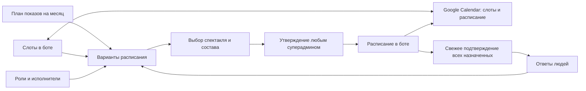

# FoShoo: переделка планирования и устройства бота

**Статус на 13 октября 2026: работа приостановлена по решению пользователя.** Согласованные решения, CJM и четыре интерактивных макета сохранены. Сначала переносим текущую рабочую версию бота на другой сервер; переделка архитектуры не входит в перенос. После возобновления продолжаем с обсуждения макетов, не пересогласовывая уже принятые правила. План переноса: [хостинг и восстановление](hosting-migration.md).

Черновик от 6 октября 2026, обновлён по решениям от 9 октября 2026. Это проект будущей модели, а не описание уже работающих функций. Код и рабочие данные в рамках этого плана не меняются.

Логика экранов и пути пользователей вынесены в [CJM интерфейса](interface-cjm.md): актёр, показы месяца, репетиции, альтернативные слоты, форс-мажоры и ведение спектакля. Согласованные правила отделены от предложений по реализации.

## 1. Направление, заданное пользователем

- Планирование начинается со свободных дат/временных слотов и доступности людей. Утверждённое событие появляется позже.
- Сначала планируются публичные показы, затем репетиции. Показы и репетиции утверждает любой суперадмин; отдельное согласование директором не требуется.
- Свободный слот уже является событием в Google Calendar с нейтральным названием, без спектакля. Создать слот можно и в календаре, и в боте. После утверждения у него появляются конкретный спектакль и состав.
- Утверждённая репетиция всегда относится к спектаклю. Полный состав обязателен для публичного показа; полезность репетиции при неполном составе пока определяет суперадмин вручную. Расчёт по сценам — в бэклоге.
- Нужны три сценария опросов: месячный для показов; необязательный недельный для проверки альтернативных слотов; оперативный для утверждённой репетиции.
- Google Sheets «График [составы]» больше не должен быть основой расписания. Его работу забирает планирование в боте.
- Связи «человек — роль — спектакль» тоже переносим в бот.
- Обычный вход должен зависеть от участия хотя бы в одном подключённом чате, без отдельного листа всего театра.
- Участники видят общую доступность и составы, включая людей из других чатов. Возможность просмотра не даёт права редактировать чужие ответы или утверждать события.
- Приложение хранит опросы и итоговые ответы. Telegram — удобный способ проголосовать; его встроенные счётчики могут отличаться от актуальных результатов в приложении.
- Общие опросы отправляются в выбранные админом чаты; ту же кампанию можно позже дослать в другой подключённый чат с сохранением ответов.
- Оперативное подтверждение запрашиваем у всех назначенных на репетицию, включая уже ответивших ранее. Опрос и напоминания по конкретной репетиции идут в чат её спектакля.
- Ассистент должен проверяться на соответствие каждой новой функции и изменению правил.
- Настройки и ресурсы нужно разложить по пользовательским задачам.
- Ранее принятое ограничение сохраняется: помещение одно. Не строим систему распределения нескольких залов.
- Запуск опросов командами/упоминаниями в чате в этот план первой версии не включён.

В текущем коде доступность хранится по человеку и дате. В будущей модели планируем по слотам с указанным временем; доступность остаётся общей между спектаклями и чатами. Правила сопоставления пересекающихся интервалов ниже — предложение по реализации. Старые ответы по дням сохраняют исходную точность.

## 2. Что сейчас мешает

По коду на начало обсуждения:

| Область | Как устроено сейчас | Следствие |
|---|---|---|
| Календарь | `CalendarEvent` синхронизируется с Google; спектакль определяется из названия или ручного выбора для опроса | Событие нужно завести раньше, чем выяснили, что на него можно собрать |
| Планирование | Даты и назначения читаются из «График [составы]», роли — из «Составы спектаклей» | Отсутствующая строка или несовпавшее имя влияет на бизнес-логику |
| Доступность | `DayAnswer` уже хранит общий ответ человека на дату независимо от чата | Хорошая основа, но нельзя различать доступность утром и вечером |
| Опросы | Обычные и месячные опросы имеют разные модели публикаций | Пользователю приходится понимать происхождение ответа и несколько сценариев управления |
| Вход | Проверка подписи Telegram, глобальных ролей, админства прежней группы и username в Sheets | Новые чаты сами по себе не дают участникам вход; остаётся зависимость от таблицы |
| Ассистент | `tools.py`, `context.py`, текст инструкций в `services.py` | Возможности, описания и правила можно обновить несогласованно |
| Навигация | В настройках одновременно права, чаты, автоматизация и запуск кампании; в ресурсах ссылки и загрузка афиши | Разделы не соответствуют задачам человека |

Существующие общий журнал ответов, историю, защиту от повторной отправки, проверку подписи Telegram и расчёт совместимого состава следует сохранить или перенести с проверкой поведения.

## 3. Основной процесс

Бот хранит исходные данные, кампании, ответы и решения. Telegram собирает ответы и доставляет сообщения. Google Calendar показывает свободные слоты и утверждённое расписание. При назначении на уже связанный слот обновляем его Google-событие, сохраняя ID. Изменение ответа пересчитывает варианты и показывает последствия, но не отменяет утверждённую репетицию и не меняет её спектакль без решения суперадмина.

## 4. Сущности и связи

| Сущность | Смысл и связи |
|---|---|
| Человек | Одна карточка на человека: постоянный внутренний ID, связанный Telegram user_id, отображаемое имя. Username и написание имени не являются ключами |
| Спектакль | Репертуарная единица: роли, материалы, чат, ответственные. Может существовать без текущих репетиций |
| Роль и допуск исполнителя | Роль принадлежит спектаклю. Связь человека с ролью означает «может исполнять», допускает дублёров; это ещё не назначение на дату |
| Слот | Конкретное окно времени и места, доступное для планирования. До назначения нет спектакля; в календаре уже есть нейтральное событие. Создаётся с любой стороны и связывается с Google ID. Повторяющийся шаблон создаёт отдельные слоты |
| Ответ о доступности | Человек + дата/интервал + «могу / не могу / пока не знаю», ограничения, источник и время обновления. Общий для всех спектаклей и чатов |
| План показов на месяц | Выбранные директором спектакли, желаемое число показов и приоритеты, допустимые даты. Утверждение этого плана не означает автоматическое утверждение конкретных событий |
| Вариант расписания | Гипотеза: слот + показ/репетиция + спектакль + предлагаемый состав. Программу репетиции можно описать свободным текстом. Несколько вариантов могут конкурировать за один слот |
| Утверждённое событие | Решение суперадмина: время, тип, обязательный спектакль, состав, описание задачи, статус. Имеет стабильный ID и связь с Google-событием слота |
| Назначение на событие | Конкретный человек назначен на конкретную роль/задачу. Отдельно от его общей доступности и списка ролей, которые он умеет играть |
| Кампания опроса | Цель, период, предлагаемые слоты, аудитория, срок ответов. Три сценария используют общую систему ответов |
| Публикация | Сообщение/опрос/ссылка кампании в определённом чате, Telegram poll_id/message_id, состояние доставки. Не создаёт отдельной доступности человека |
| Чат и членство | Подключённый суперадмином чат, участники, актуальность проверки. Связь со спектаклем определяет рассылку, членство — обычный вход |

Сцены, их роли и обязательность участников — будущее расширение, не обязательная часть справочников первой версии.

Труппа при необходимости остаётся меткой/объединением людей, а не обязательным владельцем каждого слота и опроса. Для одного театра не нужна изоляция всех данных по чатам.

Первый интерфейс связей спектакля и чата остаётся простой таблицей: один чат назначения у спектакля, один чат может обслуживать несколько спектаклей. Это не мешает общей кампании публиковаться в нескольких выбранных чатах.

## 5. Доступность слотов

Для слота указываем интервал, например «суббота 12:00–15:00», с понятным часовым поясом. Ответ на весь день возможен, если вопрос прямо говорит «весь день». Не превращаем неопределённое «свободен в субботу» в подтверждение любого времени.

Правила для обсуждения:

1. Спектакль и чат не входят в ключ доступности. Смена спектакля в том же временном окне сохраняет ответы.
2. Назначение на репетицию не означает, что человек подтвердил присутствие. В карточке видны и назначение, и доступность/актуальность ответа.
3. Ответы из разных опросов и Mini App обновляют общую доступность в приложении. Для одинакового окна последнее действительно изменённое значение становится актуальным; повтор доставки и неизменённые пункты старого опроса его не перетирают. Сохраняем историю и источник. Отзыв снимает только ответ, для которого этот источник ещё актуален, и не воскрешает старый ответ.
4. «Нет ответа», «пока не знаю» и «не могу» различаются. Не ответившего нельзя автоматически считать отказавшимся.
5. Уточнение на узкий интервал имеет приоритет над более общим ответом на день. Старый месячный опрос не должен незаметно отменять оперативное уточнение; правило применимости и приоритетов закрепляем до миграции.
6. «Опоздаю» хранится как ограничение времени, например «могу с 20:00», а не превращается безусловно в «могу».
7. Перенос времени/даты проверяет покрытие нового интервала имеющимися ответами. Подтверждения конкретного события помечаются устаревшими; недостающую информацию нужно запросить.
8. Старые ответы по дням сохраняются как ответы прежней точности. Нельзя молча раздать старое «да» всем новым слотам этого дня.

Слот можно отредактировать с любой стороны. При изменении времени создаётся новая версия его временного окна; старые ответы и опубликованные вопросы сохраняют исходный смысл. Это не требует нового Google ID. Приложение показывает, для какого времени получены ответы и что нужно уточнить. Одинаковые окна в разных кампаниях должны ссылаться на общую временную область, чтобы ответы не разъезжались.

Оперативный запрос хранит отдельную отметку свежести подтверждения. Нажатие «Всё в силе» должно засчитываться даже при неизменном «могу»: это новое подтверждение прежней доступности. Простая повторная доставка старого Telegram-ответа подтверждением не считается. Если Telegram не присылает событие при повторном выборе той же опции, свежее подтверждение принимается через кнопку/форму приложения или новый опрос.

## 6. Как выбирать показы и репетиции

### Показы

Директор задаёт программу месяца: что хотим играть и с каким приоритетом. Бот для каждого слота показывает возможные спектакли и конкретное распределение исполнителей по ролям. Полный состав обязателен. Одного количества свободных людей недостаточно: роли должны закрываться совместимыми исполнителями.

На первом этапе бот предлагает варианты; любой суперадмин выбирает и утверждает конкретные показы. Автоматическое составление идеального месяца целиком — последующий этап: сначала нужно определить реальные приоритеты, фиксированные составы, доступность режиссёра и ограничения площадки.

### Репетиции в первой версии

Суперадмин выбирает слот, обязательный спектакль и нужных участников/исполнителей ролей. Бот показывает их доступность, ограничения и недостающие ответы. Полный состав спектакля для репетиции не обязателен: суперадмин решает, достаточно ли выбранных людей для запланированной работы, и при необходимости описывает задачу текстом.

Нет автоматической оценки полезности по сценам и обязательного редактора программы. Неописанные сцены не считаются ошибкой данных и не мешают утвердить репетицию. Вариант без выбранного спектакля остаётся свободным слотом, а не утверждённой репетицией.

### Бэклог: репетиции по сценам

Отложено решением от 9 октября. Ниже сохранён материал для будущего обсуждения; поля, расчёты и импорт сцен не входят в текущий объём работ.

Для сцены храним связь с ролью, а не напрямую с человеком. Человек подставляется через список допустимых исполнителей роли и доступность на слот.

Для каждой роли в сцене: «обязательна для репетиции» или «желательна». Допустимую замену/читку обозначаем явно. Эта настройка не ослабляет требования к публичному показу.

Результат расчёта: список сцен, которые можно репетировать; недостающие обязательные роли; возможные исполнители; примерная полезная длительность; кто пришёл бы без задачи. Пример: «Полный состав не собирается, но можно работать над сценами 2, 4 и 7 около 90 минут; сцене 6 не хватает исполнителя роли X».

Не ранжируем только по числу сцен: три важные длинные сцены могут быть полезнее десяти коротких. Предлагаемые критерии: обязательные роли закрыты, приоритет режиссёра, время работы помещается в слот, доступен ведущий репетиции. Админ утверждает программу.

Если программа состоит из последовательных блоков, человек не может закрывать две одновременно нужные роли в одной сцене. Изменения исполнителя между сценами и работа с несколькими дублёрами требуют явной модели; не наследуем механически нынешнее правило «один человек — одна роль на весь спектакль» для любого вида репетиции.

Сцены можно импортировать таблицей/структурированным файлом или прислать текстом. Ассистент готовит разбор с предпросмотром, админ подтверждает роли и обязательность. Система не угадывает критичность персонажа из текста пьесы без проверки.

### Один зал

В первой версии одно помещение, без сложного поиска пересечений актёров и маршрутов между площадками. Достаточно не позволять утвердить два события на пересекающееся время одного зала. Конкурирующие гипотезы до утверждения допустимы. В слот нужно включать подготовку/сбор, если доступность на него обязательна.

## 7. Три сценария опросов

| Сценарий | Что задаёт админ | Что отвечает человек | Что происходит дальше |
|---|---|---|---|
| Показы на месяц | Репертуар, возможные окна показов, выбранные чаты и срок ответов | Доступность на конкретные окна | Любой суперадмин выбирает из вариантов полных составов и утверждает показы |
| Альтернативы на неделю | Несколько свободных слотов для проверки гипотезы | Доступность на предложенные окна | Сравнение текущего плана с альтернативами; расписание само не меняется |
| Утверждённая репетиция | Существующее событие, его время и назначенные участники | Свежее подтверждение каждого участника и ограничения | Видны изменения состава; суперадмин решает, менять ли участников, задачу или время |

Месячный опрос не является голосованием за популярность спектакля: репертуар выбирает директор. Выбранные чаты определяют аудиторию, но не ограничивают смысл «могу» конкретным спектаклем.

Существующий подход «один человек — один актуальный ответ на время» сохраняется. Если ответ уже есть, Mini App показывает его сразу. В общих кампаниях повторно отвечать не нужно. Оперативный опрос репетиции запрашивает новое подтверждение у всех назначенных, даже у ранее ответивших «могу». Отсутствие нового подтверждения не стирает прежний ответ; рядом виден статус «Ждём свежего подтверждения».

Тегание различает «вообще нет доступности» и «не подтвердил её заново». «Спрашивать всех» в оперативном сценарии означает всех назначенных на эту репетицию, а не весь театр. Для месячного планирования аудитория — исполнители выбранных спектаклей. Не напоминаем одному человеку во всех общих чатах одновременно. Оперативный опрос и напоминания направляются только в настроенный чат спектакля.

### Одна анкета в нескольких чатах

Желаемый UX: «Это общий опрос. Отметьтесь один раз, даже если видите его в нескольких чатах».

Кампания и итоговые ответы хранятся в приложении независимо от публикаций. Админ выбирает подключённые чаты перед запуском. В открытой кампании есть действие «Дослать в другой чат»: добавляется публикация той же кампании, уже собранные ответы сохраняются, успешные отправки не повторяются. Новые участники аудитории видят ту же форму. Уже ответившим не нужно голосовать повторно; неотвеченные пункты видны отдельно. Закрытая кампания не возобновляется незаметно при добавлении чата.

Один из способов ввода — созданный ботом неанонимный Telegram-опрос с пересылками и отдельным поясняющим сообщением. Поведение пересланного опроса необходимо проверить на тестовом боте до выбора реализации: одинаковый poll_id, ответ участника другого чата, повторное голосование, изменение/отзыв ответа, остановка, ограничения пересылки, отсутствие зависимости от членства в исходном чате. Если период не помещается в один опрос, нужны части одной кампании, а не обещание одного сообщения на любой объём.

Общая форма Mini App позволяет просмотреть и изменить итоговые ответы, включая интервалы и «пока не знаю». Она открывается из сообщений во всех выбранных чатах. Если нативный опрос не подходит для вопроса, сообщение ведёт сразу в форму.

Согласованное ограничение: изменение ответа в приложении не обязано менять галочки и счётчики нативного опроса. Бот не голосует за пользователя; Telegram допускает вызов метода голосования только пользовательским аккаунтом. В публикации пишем «Актуальные ответы и итоги — в приложении» и даём ссылку. Планирование и напоминания используют данные приложения. [Telegram: messages.sendVote](https://core.telegram.org/method/messages.sendVote).

Telegram документирует пересылку сообщений и получение `poll_answer` для собственных неанонимных опросов бота, но этого недостаточно для доказательства всего сценария выше. Нужен практический тест. [Bot API: forwardMessage](https://core.telegram.org/bots/api#forwardmessage), [Update](https://core.telegram.org/bots/api#update).

## 8. Убираем Google Sheets из расписания и составов

В БД бота переносятся люди, допуски к ролям, слоты, ответы, назначения и утверждённые события. Редактирование идёт через Mini App; ассистент использует те же операции. Для слотов дополнительно поддерживается создание и изменение в Google Calendar. Сцены переносятся только на отложенном этапе.

Планирование составов становится основным экраном работы с этими данными. Отсутствующая строка «Лера Коршунова» во внешней таблице больше не влияет на возможность учесть ответ.

Google Calendar — второй вход для работы со слотами и представление общего расписания. Предлагаемое обозначение свободного окна — «Слот» или `[Слот]`; конкретное название/маркер ещё выберем. Слот не требует спектакля или труппы. Созданный в Google слот появляется в боте; созданный в боте — в Google. Утверждение связывает его со спектаклем и составом и обновляет существующее событие, а не добавляет рядом второе.

Одного свободного текста недостаточно для надёжного распознавания: фиксируем признак слота и стабильную связь с календарным событием. Неизвестное внешнее событие нельзя молча считать свободным окном. Нужен предпросмотр импорта; чужие события не удалять.

Для синхронизации храним версию и последнее согласованное состояние. Несовместимые правки с обеих сторон показываем как конфликт с выбором результата. Изменение времени сохраняет старые ответы на исходное окно и запускает проверку доступности на новое. Переименование в Google само по себе не утверждает спектакль и состав: это решение в боте. Для изменений времени/удаления уже утверждённых событий нужен видимый разбор последствий, без тихой отмены или перезаписи назначений. Так календарь остаётся доступным для работы со слотами, а решения о составе — в приложении.

Утверждение и синхронизация имеют разные статусы. «Утверждено, ожидает отправки в Google» допустимо при сбое API, но видимо администратору. Повторная отправка использует стабильный ID и не создаёт дубль. Создание, изменение и отмена проходят одной последовательностью с историей и повторяемыми операциями.

Финансы и другие данные Sheets не переносятся автоматически в рамках переделки расписания: их судьба отдельное решение.

При этом все потребители профиля человека — включая финансовые формы и контекст ассистента — должны перейти на карточку в боте. Оставшиеся финансовые листы не должны заставлять заново вести общий список участников ради сопоставления имён.

## 9. Вход через объединение чатов

Правило обычного входа: Telegram подтвердил личность пользователя, и он состоит хотя бы в одном активном чате, явно подключённом суперадминистратором. Состоять во всех чатах не нужно. Вход по строке в Sheets убирается.

Проверка подписи `initData` остаётся обязательной: членство отвечает за доступ, подпись — за то, чей именно Telegram ID проверяем. Не доверяем user_id из параметра ссылки.

Бот проверяет конкретного пользователя через `getChatMember`; для гарантированной проверки других пользователей он должен быть администратором подключённого чата. [Документация Telegram](https://core.telegram.org/bots/api#getchatmember).

Профиль человека создаётся при первом известном боту взаимодействии; username необязателен. Список всех членов каждой группы нельзя считать автоматически готовым списком актёров: Bot API не даёт обычной полной выгрузки всех участников. Для ролей нужны известные профили либо импортированные карточки с последующим связыванием с Telegram ID. Не связываем одноимённых людей автоматически.

Поддерживаем короткий кэш членства, события входа/выхода и повторную проверку. Чтобы получать `chat_member`, нужно явно включить этот тип обновлений. Выход из всех чатов отзывает обычный доступ; потеря сети не должна притворяться подтверждённым отсутствием членства. Глобальное администрирование хранится отдельно, чтобы суперадмин мог исправить подключение. [Bot API: Update](https://core.telegram.org/bots/api#update).

Права и видимость:

- Участник: меняет свои ответы, видит общее расписание, доступность и составы коллег из всех подключённых чатов. Просмотр чужого ответа не даёт права его менять.
- Администратор спектакля: предлагаемый объём — роли и исполнители, кампании и варианты расписания в своей области. Право утвердить событие есть только при наличии роли суперадмина.
- Директор задаёт желаемую программу месяца; это задача, а не дополнительная обязательная ступень согласования каждого события.
- Любой суперадмин утверждает показы и репетиции, меняет утверждённые назначения; подключает чаты, управляет полномочиями и интеграциями.

Админство обычного Telegram-чата спектакля само по себе не выдаёт суперадминство и доступ к финансам. Способ назначения администраторов спектакля уточняется при реализации прав. Видимость финансов определяется отдельно: новое условие входа и общая видимость составов не расширяют её автоматически.

### Предложение: суперадмины из отдельной группы

У команды уже есть отдельная группа суперадминов. Предлагается использовать членство в ней как источник прав, сохранив персональные назначения:

1. Директор добавляет бота в эту группу администратором. Это позволяет надёжно проверять членство через `getChatMember` — требование Telegram приведено выше.
2. Действующий суперадмин в «Настройки → Доступ» указывает именно эту группу как источник суперадминов и проверяет её название. Добавление бота в произвольный чат не включает такую выдачу прав.
3. Любой человек, состоящий в выбранной группе, получает роль суперадмина при проверке доступа. Быть Telegram-администратором группы ему не обязательно. Источник права виден в приложении: «Группа суперадминов».
4. Персонально выданные права сохраняются независимо от группы. Существующий персональный доступ владельца проекта, которого в группе нет, остаётся; входить в неё специально не требуется.
5. Выход из группы снимает только право, полученное через неё. Если у человека есть персональное назначение, оно продолжает действовать. Не копируем членство в бессрочный список ручных суперадминов.
6. Изменения членства обновляют кэш; перед утверждением и управлением доступом проверяем актуальность полномочий. Сбой Telegram показывается как невозможность проверки, а не как подтверждённый выход. Персональный доступ позволяет восстановить подключение группы.

Подключение этой группы не создаёт спектакль, не делает её адресатом опросов и не требует полного экспорта списка участников. Это отдельная настройка доступа. Схема предложена по замечанию пользователя; саму группу в рамках этого документа не подключаем.

Постоянно поддерживать лист всего театра больше не нужно. Но карточки людей для назначения ролей всё равно существуют внутри бота; участие в чате само по себе не говорит, какую роль человек играет.

## 10. Устройство приложения и ассистента

Предложение: сохранить React, FastAPI и один бот. Разделить ответственность внутри одного приложения, без обязательного перехода на микросервисы или смены стека.

Модули: люди и доступ; репертуар и роли; слоты и доступность; планирование; утверждённое расписание; кампании и доставки; интеграции; ассистент. Сцены добавятся как расширение репертуара позже. Правила находятся в сервисах предметной области. HTTP API, Telegram и ассистент вызывают эти сервисы; ассистент не должен содержать отдельную версию правил или напрямую управлять Google.

Внешние записи выполняются через сохраняемую очередь операций: публикация календаря, опрос, напоминание. У операции есть состояние и причина ошибки; перезапуск безопасно продолжает работу. Для старых неоднозначных отправок сохраняем запрет на слепой повтор. Сетевые вызовы не должны удерживать операции голосования или авторизации.

Для схемы БД нужны версионные миграции, резервная копия и проверка преобразований. Решение о переходе с SQLite на другую БД принимается по требованиям к конкурентным записям и эксплуатации, а не как обязательная часть пересборки интерфейса.

### Актуальность «скиллов» ассистента

В этом проекте речь о функциях внутреннего ассистента FoShoo: его реестре tools, контексте, инструкциях и сценариях проверки.

Для каждой пользовательской возможности заводим запись: операция, схема аргументов/результата, права, нужен ли предпросмотр, доступность в интерфейсе и ассистенте, примеры запросов, связанные проверки. Описания и схемы инструментов собираются из этого реестра; доменные правила вызываются из общих сервисов.

В каждом изменении бота обязателен ответ: что изменилось для ассистента или почему ничего. Автоматическая проверка изменений маршрутизирует затронутые возможности, сверяет схемы/регистрацию/права и запускает соответствующие сценарии. Отдельная проверка содержания оценивает полноту сценариев и правдивость текста: один проход сборки не доказывает, что ассистент знает все новые функции.

Критерий завершения функции: интерфейс, операция сервиса, права, контекст/инструмент ассистента и сценарии согласованы; либо явно записано, почему действие доступно только через интерфейс. Правило добавляется в инструкции проекта и проверку изменений. Финальное действие ассистента повторно проверяет актуальные данные и права, даже если предпросмотр был показан раньше.

## 11. Навигация по задачам

Предложение верхнего уровня: **Моё / Планирование / Театр / Финансы**. Ассистент доступен из любого раздела и получает контекст открытого объекта; это предложение, место ассистента можно пересмотреть отдельно.

| Раздел | Содержимое |
|---|---|
| Моё | Ближайшие репетиции и показы с моим участием, неотвеченные опросы и свежие подтверждения, изменения; личная доступность и переход в общее расписание |
| Планирование | Общее расписание со свободными слотами, доступность и составы для всех; месячная программа, сравнение альтернатив, запуск кампаний и утверждение — по правам |
| Театр | Спектакли, роли и исполнители, материалы конкретного спектакля; общая библиотека ссылок и публикации/афиши. Сцены — в бэклоге |
| Финансы | Нынешние финансовые сценарии, с отдельно заданными правами |
| Настройки через отдельный вход | Личные уведомления; для уполномоченных — чаты, доступ, интеграции и правила автоматизации |

Запуск опроса — действие в планировании/событии, а не настройка. Роли — карточка спектакля. Текст пьесы/видео — его материалы. Загрузка афиши — публикация спектакля/показа. Раздел «Ресурсы» как набор несвязанных кнопок перестаёт существовать. Сцены не появляются как пустой обязательный раздел до реализации отложенного этапа.

## 12. Последовательность работ и критерии приёмки

| Этап | Результат | Что проверяем перед переходом |
|---|---|---|
| 0. Согласовать модель | Сущности, смысл доступности, права, три пользовательских сценария и макеты главных экранов | На конкретной неделе можно пройти путь от слота до показа/репетиции без ручных исправлений таблицы |
| 1. Проверить интеграционные предположения | Тесты общей анкеты/пересылок, доступа через чаты и синхронизации нейтрального слота | Один человек не дублируется; отзыв ответа работает; досылка не сбрасывает ответы; членство и персональные права независимы; событие сохраняет Google ID |
| 2. Люди, спектакли, роли в боте | Импорт составов с предпросмотром, редактор, привязка Telegram, новая проверка входа и источники суперадминства | Дублёры/однофамильцы обработаны; выход из группы отзывает только полученные через неё права; Sheets не нужен для входа и ролей |
| 3. Слоты и общее планирование | Создание слотов в боте и Google, общие ответы в БД, кампании на месяц/неделю, расчёт полных составов | Работает без «График [составы]»; правки времени не переносят старые ответы; новые чаты получают ту же кампанию |
| 4. Утверждение и оперативные опросы | Любой суперадмин назначает спектакль и состав; Google-событие обновляется; все назначенные дают свежее подтверждение | Репетицию без спектакля не утвердить; два решения не занимают один зал; сбои не создают дублей; прежнее «могу» сохраняется отдельно от свежести |
| 5. Завершить перенос интерфейса | Навигация по задачам, материалы у спектаклей, технические настройки отдельно | Все видят общую доступность и составы; действия учитывают права; пользователь не ищет запуск опроса в настройках |

Навигацию, контракт возможностей и проверки ассистента закладываем с этапа 0 и дополняем на каждом этапе; не откладываем их на конец. Этапы 2–4 образуют минимальный законченный переход от Sheets к планированию в боте. Сцены, их импорт и рекомендации программы находятся в бэклоге без обязательного срока; они не блокируют этот переход.

### Перенос без потери истории

1. Снимок БД и источников; опись людей, ролей, назначений, ответов, событий и активных публикаций.
2. Импорт с отчётом о неоднозначных именах, датах и отсутствующих Telegram ID. Сначала предпросмотр, затем подтверждение.
3. Новый расчёт работает параллельно для сравнения на копии данных, без двойных рассылок и двойной записи наружу.
4. На согласованной границе источником перенесённых данных становится БД бота; соответствующие листы Sheets остаются архивом/выгрузкой. Слоты по-прежнему можно редактировать через Google с синхронизацией в бот. Старую фоновую запись ответов в график отключаем; уже сохранённые ответы и историю сохраняем.
5. Старые Telegram-опросы и их ID не удаляются. Их ответы обрабатывает совместимый обработчик с сохранением прежней точности даты и истории; неактуальные кампании закрываются контролируемо.
6. У существующих Google-событий сохраняются ID; не создаём все события заново. Финансовые листы и прочие независимые функции не затрагиваем без отдельного решения.
7. Для отката сохраняем новые ответы и журнал изменений. Нельзя просто вернуть старую БД поверх данных, собранных после переключения.

## 13. Решения от 9 октября и дальнейшая детализация

Согласовано: любой суперадмин утверждает показы и репетиции; слоты создаются в календаре и боте; у репетиции обязательно есть спектакль; расчёт по сценам отложен; чаты общей кампании выбирает админ и может дополнить позже; итоговые ответы хранятся в приложении; оперативно спрашиваем всех назначенных. Сохраняются общий просмотр доступности/составов и приоритет публичных показов перед репетициями.

Для следующих макетов не требуется заново выбирать эти правила. В детализации предстоит определить:

- обозначение нейтрального слота в Google и поведение при правках серии/конфликте синхронизации;
- правила пересекающихся интервалов и перенос старых ответов по дням без изменения их смысла;
- особые ограничения совместимости исполнителей и участие режиссёра/ведущего;
- срок оперативного запроса и настройки автоматического запуска; его аудитория уже определена — все назначенные;
- предложенный механизм суперадминства из отдельной группы плюс персональные назначения; права админа спектакля и финансовые права описываются отдельно.

Следующий результат обсуждения — макеты ключевых экранов по CJM, затем технические задачи по этапам. Детализация сцен остаётся отдельным будущим обсуждением.
