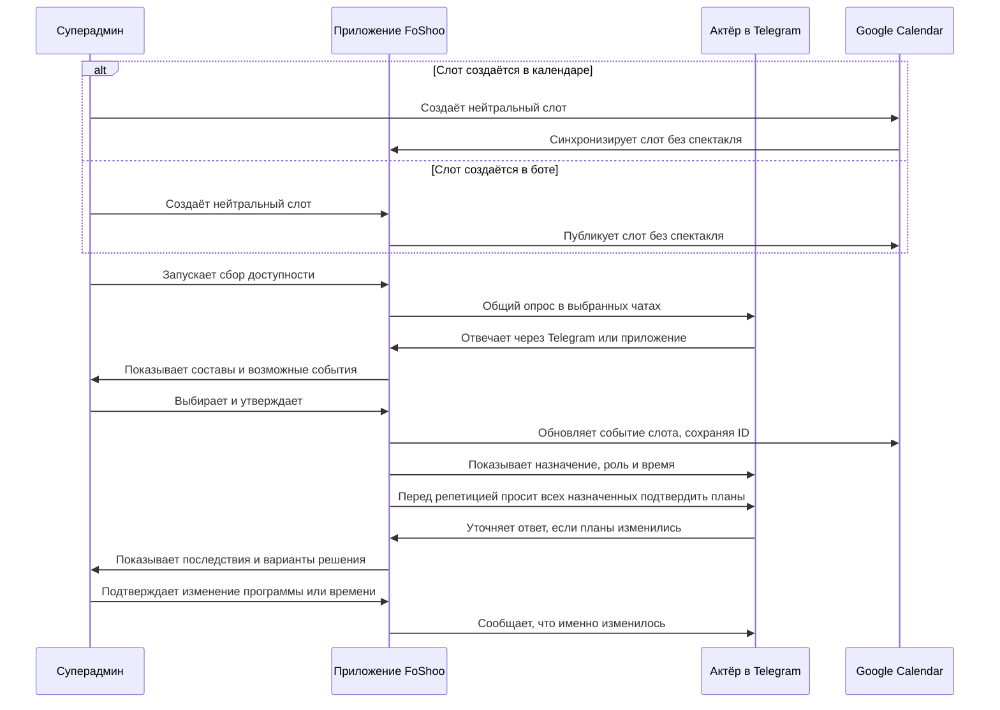

# FoShoo — CJM и логика интерфейса

**Версия 0.2 · 9 октября 2026 · черновик с учётом ответов пользователя.**

**На паузе с 13 октября 2026.** Сначала переносим действующего бота на новый сервер. Четыре интерактивных макета от 10 октября сохранены в `docs/mockups/foshoo-interface.html`; после переноса возвращаемся к их обсуждению. Решения ниже остаются действующими для будущей переделки, но не описывают уже внедрённые функции.

Основа: [план переделки архитектуры](architecture-redesign.md). Здесь описан желаемый опыт, а не текущий интерфейс. Ожидания и затруднения пользователей — проектные гипотезы, не результаты интервью.

Править можно прямо в таблицах. У шагов есть обозначения: например, «A3 — хочу отвечать прямо в Telegram», «R2 — хочу иначе сравнивать составы». Это позволяет обсуждать конкретный момент пути.

## 1. Согласованные правила

| Вопрос | Решение |
|---|---|
| С чего начинается планирование? | Со свободного слота — события с временем и нейтральным названием, пока без спектакля. Его можно создать в Google Calendar или боте; он виден с обеих сторон до утверждения |
| Что имеет первый приоритет? | Директор задаёт желаемые публичные показы месяца; сначала планируем показы, затем репетиции |
| Кто утверждает? | Любой суперадмин утверждает и показ, и репетицию. Дополнительное согласование директором не нужно |
| Может ли репетиция быть без спектакля? | Нет. Без выбранного спектакля это свободный слот. С неполным составом репетировать можно; достаточность состава пока оценивает суперадмин вручную |
| Что со сценами? | Расчёт, редактор и импорт сцен — в бэклоге. В первой версии можно написать задачу репетиции обычным текстом |
| Где отвечать и смотреть итог? | Приложение хранит кампании и итоговые ответы; Telegram — удобный способ ввода. При расхождении с галочками/счётчиками Telegram актуальны данные приложения |
| Куда отправлять общий опрос? | В выбранные админом подключённые чаты. Позже можно дослать ту же кампанию в другой чат, сохранив ответы |
| Кого спрашивать перед репетицией? | Всех назначенных на неё, в том числе ранее ответивших. Опрос и напоминания — только в чате этого спектакля |
| Где главная? | «Моё»: неотвеченные опросы, ближайшие репетиции/показы, изменения и переход в общее расписание. Ссылка из сообщения открывает конкретный опрос или событие |
| Что видят коллеги? | Все участники видят доступность и составы всех, включая людей из других групп. Редактирование и финансовый доступ зависят от отдельных прав |

Зафиксированные ориентиры: доступность общая между чатами и спектаклями; Google-таблица расписания не нужна; роли живут в боте; зал один. Команду или упоминание бота для запуска опроса не добавляем.

**Предложение по суперадминам:** членство в отдельной, явно подключённой группе даёт эти права автоматически; персональные назначения сохраняются независимо от группы. Это сохраняет доступ владельца проекта, которого в группе нет. Подключение описано в T6; схема пока является планом, действующие права не меняются.

## 2. Общая карта пути



**Главная развилка:** ответ «могу» заполняет доступность. Слот в календаре ещё не является назначением. Только утверждение суперадмина фиксирует спектакль и участников. Изменение ответа пересчитывает варианты, но само не отменяет событие.

## 3. Входы и разделы

| Точка входа / раздел | Первый экран и содержание | Основное действие |
|---|---|---|
| Сообщение с опросом | Конкретный опрос: зачем собираем ответы, на какие даты, до какого срока; ранее данные ответы уже видны | «Ответить» / «Изменить ответы» |
| Сообщение о событии | Карточка события: утверждено ли оно, время, место, моя роль, программа, последние изменения | «Моя доступность» |
| **Моё** | «Нужно ответить», «Ближайшее участие», «Изменения»; переходы к моей доступности и общему календарю | Ближайшее незавершённое действие |
| **Планирование** | «Расписание» со свободными слотами, «Варианты», «Опросы»; общая доступность и составы. Админу — месячная программа и управление | Посмотреть данные; по правам — «Запланировать» / «Собрать доступность» |
| **Театр** | Спектакли. Внутри: «Состав», «Материалы», «Показы и репетиции». Сцены появятся после отдельной реализации | Открыть нужный спектакль |
| **Финансы** | Финансовые действия и данные в пределах прав пользователя | Существующие финансовые сценарии |
| **Настройки** | Личные уведомления; для уполномоченных — чаты, права, подключения и автоматизация | Изменить правило или подключение |
| Ассистент | Доступен из раздела или карточки; понимает, какой объект открыт | Помочь выполнить то же действие через диалог |

Общая доступность и составы доступны всем участникам в просмотре. Кнопки редактирования, рассылки и утверждения появляются по правам; утверждение — только у суперадмина. Человек с несколькими полномочиями пользуется одним приложением, без переключения «режима актёра» и «режима директора».

Для телефона основной вид расписания — список по дням. Сравнение «слоты × спектакли» находится в планировании: на телефоне сначала выбирается слот, затем показываются варианты; широкая таблица может оставаться дополнительным видом.

## 4. CJM A — актёр: получить запрос и сообщить доступность

**Цель:** быстро сообщить, когда могу, понять, куда меня назначили, и не отвечать повторно в каждом чате.

**Начало:** пришёл общий опрос или человек открыл приложение. **Успех:** ответ сохранён, его область действия понятна; будущие назначения видны отдельно.

| Шаг | Намерение / ожидание | Экран и действие человека | Видимый результат | Возможное затруднение → поддержка |
|---|---|---|---|---|
| A1. Получить запрос | «Что от меня хотят и до когда?» | Сообщение в чате: цель, период, срок и кнопка «Ответить»; либо сам Telegram-опрос | Понятно, что это общий сбор доступности, а не уже назначенная репетиция | Человек видит сообщение в двух чатах → текст «Достаточно ответить один раз» |
| A2. Войти | «Пустите сразу к вопросу» | Переход в конкретную форму. Проверка доступа выполняется автоматически | Участник хотя бы одного подключённого чата попадает в форму; лист участников заполнять не нужно | Проверка временно не работает → «Не удалось проверить доступ» + «Повторить», а не ложное «Вас нет в театре» |
| A3. Ответить | «Вот когда я свободен» | Список дат/окон. Для каждой строки: «Могу», «Не могу», «Пока не знаю»; ограничения времени по необходимости | Ранее данные ответы подставлены с датой обновления. Пустая строка явно означает «Нет ответа» | Много дат → можно отвечать частями; заполненные строки не сбрасываются |
| A4. Сохранить | «Хочу быть уверен, что ответ дошёл» | В форме — «Сохранить ответы». В нативном опросе — обычное голосование Telegram, без второго сохранения в приложении | «Ответы сохранены. Они учитываются во всех спектаклях на это время»; оставшиеся пустые даты видны | Сеть оборвалась → введённое остаётся, предлагается повторить; до подтверждения нет надписи «Сохранено» |
| A5. Открыть из другого чата | «Я уже отвечал» | Та же кампания или «Моё → Доступность» | Видны существующие ответы, включая кампанию, досланную в новый чат; основное действие — «Изменить» | Галочка Telegram не совпадает с ответом, изменённым в Mini App → «Актуальные ответы и итоги — в приложении» со ссылкой |
| A6. Узнать назначение | «Куда и зачем мне приходить?» | «Моё → Ближайшее участие» или сообщение об утверждении | Конкретные спектакль, время/место, роль и описание задачи, если задано. Только утверждённое событие выглядит как обязательство | «Я нажал “могу”, значит меня уже ждут?» → доступность и назначение подписаны отдельно |
| A7. Изменить планы | «Теперь я не могу / буду позже» | В событии или доступности — изменение ответа; при затрагивании назначения видно, какого именно | Ответ обновлён, в карточке «Администратор видит изменение»; назначение остаётся до его решения | Человек не знает, кому писать отдельно → видно, что изменение требует решения ответственного |

Повторное подтверждение не требуется при каждом открытии или появлении кампании в новом чате. Оперативный запрос перед репетицией приходит всем назначенным: «Ранее вы отметили “могу”. Подтвердите планы на эту репетицию» → «Всё в силе» / «Изменились». Нажатие «Всё в силе» засчитывает свежий ответ даже при неизменной доступности. До ответа показываем прежнее значение и «Ждём свежего подтверждения»; не заменяем его на отказ.

Нативные галочки и счётчики Telegram не отражают правки из приложения автоматически. Для планирования, статуса ответа и напоминаний используем итог в приложении; ссылка на него есть в публикации кампании. Вариант с пересылкой одного нативного опроса остаётся технической гипотезой до проверки.

## 5. CJM M — директор и суперадмин: спланировать показы месяца

**Цель:** выбрать выполнимую программу месяца, получить конкретные составы и утвердить расписание.

**Начало:** нужно составить программу нового месяца. **Успех:** показы утверждены, назначения видны актёрам, публикация в календаре выполнена или её задержка явно показана.

| Шаг | Намерение / ожидание | Экран и действие человека | Видимый результат | Возможное затруднение → поддержка |
|---|---|---|---|---|
| M1. Задать намерения | «Что хотим играть в этом месяце?» | Директор задаёт в «Планирование → Варианты → План месяца» спектакли, желаемое число показов, приоритеты | Черновая программа; слоты календаря ещё не назначены конкретным спектаклям | Нет спектакля → переход к созданию/импорту в «Театре» с возвратом к плану |
| M2. Задать окна | «Когда у нас есть площадка?» | Создать слот в боте или Google Calendar; в боте также возможен шаблон | Свободные окна с нейтральным названием видны с обеих сторон, ещё без спектаклей | Синхронизация задержалась → отдельный статус; изменение времени после ответов требует их проверки |
| M3. Подготовить опрос | «У кого и что спросить?» | «Собрать доступность → Показы на месяц»: проверить даты, выбранные спектакли, чаты и срок | Предпросмотр текста и списка чатов; виден объём уже имеющихся ответов | У спектакля нет чата → пометка у строки и путь к настройке; не скрываем проблему после запуска |
| M4. Запустить и наблюдать | «Уже можно принимать решение?» | Запустить; открыть «Опросы → эта кампания». При необходимости — «Дослать в другой чат» | Ответы и статусы по чатам; при досылке сохраняется та же кампания и все ответы | Часть сообщений не отправилась → повтор только нужной отправки; выбран уже получивший чат → видна существующая публикация |
| M5. Сравнить варианты | «Какой показ здесь реально собрать?» | Для слота открыть список спектаклей и составов; при необходимости сменить исполнителя роли | «Полный состав», «Нужны ответы по двум ролям», «Нет исполнителя роли X» с объяснением | Один актёр подходит на две нужные роли → считаем совместимое распределение, а не только число людей |
| M6. Утвердить | «Это наш окончательный выбор» | Любой суперадмин: предпросмотр спектакля, времени, места, ролей и получателей → «Утвердить показ» | Фиксируются событие и назначения; существующий слот Google получает конкретный показ. Окно занято | Пока смотрели, ответы изменились или слот уже занят другим решением → показать изменения до утверждения |
| M7. Проверить результат | «Все знают и календарь обновился?» | Карточка события и список расписания | Видны утверждение, публикация в Google и доставка сообщения | Google недоступен → «Утверждено, календарь ещё обновляется»; новый дубль события создавать не нужно |

Пока полного состава нет, можно сохранить вариант, запросить недостающие ответы или выбрать другое окно. В этой версии карты публичный показ без полного состава не утверждается. Возможность ручного исключения — отдельное решение, не скрытая кнопка обхода.

## 6. CJM R — суперадмин: назначить репетицию спектакля

**Цель:** использовать доступное время с пользой, даже если полный состав спектакля не собирается.

**Начало:** есть свободный слот и текущие ответы. **Успех:** выбран спектакль, утверждён нужный состав и понятна задача репетиции. Расчёт сцен для этого не требуется.

| Шаг | Намерение / ожидание | Экран и действие человека | Видимый результат | Возможное затруднение → поддержка |
|---|---|---|---|---|
| R1. Выбрать окно | «Что можно поставить сюда?» | «Планирование → Варианты»: слот → «Репетиция» | Варианты спектаклей на основе текущей доступности, без обязательного нового опроса | Ответов мало → «Уточнить доступность» или проверить другие окна |
| R2. Выбрать спектакль | «Кого получится собрать?» | Карточка варианта: роли, доступные исполнители, ограничения и неизвестные ответы | Видно, кого можно пригласить. Суперадмин оценивает, достаточно ли их для работы | Полного состава нет → репетицию всё равно можно подготовить; автоматической оценки по сценам пока нет |
| R3. Выбрать участников | «Кого зовём и что делаем?» | Отметить участников/исполнителей ролей и ведущего; при необходимости написать задачу текстом | Конкретный список назначаемых людей с их доступностью | Участник ещё не ответил → это видно отдельно от отказа; можно уточнить ответ или осознанно оставить назначение ожидающим подтверждения |
| R4. Утвердить | «Готово, можно объявлять» | Любой суперадмин: предпросмотр спектакля, времени, состава и задачи → «Утвердить репетицию» | Слот становится репетицией; Google-событие обновляется, участники получают назначения | Спектакль не выбран → «Выберите спектакль»; без него можно сохранить только свободный слот |
| R5. Открыть рабочую карточку | «Что именно делаем на этой репетиции?» | Карточка события из расписания | Спектакль, участники, задача, материалы и актуальные ответы в одном месте | Нет описания задачи → его можно дописать; отсутствие справочника сцен не считается ошибкой |

Достаточность неполного состава решает суперадмин. Программа текстом не получает отметку «рассчитано по сценам». Редактор сцен, критичность ролей, длительность и рекомендации отложены в бэклог.

## 7. CJM W — админ: проверить альтернативную неделю

**Цель:** понять, можно ли улучшить уже запланированные репетиции, не отменяя их заранее.

**Начало:** текущий состав/программа неудовлетворительны. **Успех:** альтернативу осознанно приняли либо сохранили исходный план.

| Шаг | Намерение / ожидание | Экран и действие человека | Видимый результат | Возможное затруднение → поддержка |
|---|---|---|---|---|
| W1. Сформулировать проблему | «На этой репетиции мало что можем сделать» | В событии — «Проверить другие варианты» | Создаётся связанная с событием гипотеза; действующее расписание остаётся на месте | Непонятно, отменено ли старое время → явная плашка «Пока действует прежний план» |
| W2. Предложить окна | «А если перенести на другой вечер?» | Выбрать альтернативные слоты из бота/календаря, чаты, аудиторию и срок → предпросмотр | В сообщении: «Проверяем возможность переноса. Репетиция пока остаётся…» | Люди воспринимают все варианты как приглашения → явно пишем «Свободный слот, ещё не назначено» |
| W3. Собрать ответы | «Стало ли лучше?» | Экран кампании и сравнение вариантов; при необходимости «Дослать в другой чат» | Общая доступность пополняется, сохранённые ответы видны и после досылки | Кто-то уже ответил в другом опросе → ответ переиспользуется с видимой актуальностью |
| W4. Сравнить последствия | «Стоит ли менять?» | Сравнить составы, доступных исполнителей ролей и ограничения; увидеть, кого затронет перенос | Суперадмин оценивает пользу; есть «Оставить как есть» | Больше людей не обязательно лучше → показываем конкретные роли и ответы, не только численность |
| W5. Принять решение | «Переносим / сохраняем» | Любой суперадмин утверждает замену либо закрывает гипотезу без изменений | Назначение и календарь обновлены, прежнее окно освобождено; сообщение объясняет замену | Старые ответы относились к другому времени → не подставляем их в новое окно без проверки |

Недельный опрос не обязателен по расписанию. Его можно начать и для ещё свободного слота, чтобы сравнить несколько возможных репетиций; тогда исходного утверждённого события нет.

## 8. CJM O — оперативный опрос и форс-мажор

**Цель актёра:** сообщить об изменении без поиска ответственного. **Цель админа:** быстро понять последствия и принять решение.

**Начало:** наступило время оперативного уточнения либо человек сам меняет ответ. **Успех:** новая программа или отмена явно доведена до затронутых людей.

| Шаг | Намерение / ожидание | Экран и действие человека | Видимый результат | Возможное затруднение → поддержка |
|---|---|---|---|---|
| O1. Уточнить планы | «Все ли по-прежнему смогут?» | Опрос из карточки события; автоматический запуск — по настройке. Запросить свежий ответ у всех назначенных | Публикация только в чате спектакля с точным временем; прежние ответы видны, но ещё не подтверждены заново | Человек уже отвечал «могу» → объясняем повторный запрос, предлагаем «Всё в силе» |
| O2. Сообщить изменение | «Не смогу / приду к 20:00» | Актёр отвечает в опросе или открывает «Моя доступность» в событии | Новый ответ сохранён, видны затронутые назначения | «Опоздаю» теряет смысл без времени → предлагается уточнить, с какого времени человек доступен |
| O3. Увидеть последствия | «Кто из назначенных не сможет?» | У админа в «Моё → Требует решения» и в событии | Например: «Исполнитель роли X не сможет; двое ещё не подтвердили планы» | Не смешиваем отказ и отсутствие свежего ответа; влияние на задачу репетиции пока оценивает человек |
| O4. Выбрать решение | «Меняем программу, состав или время?» | «Изменить программу», «Подобрать замену», «Проверить другие слоты», «Отменить» | Предпросмотр нового плана и затронутых участников | Свободный дублёр не равен назначенному → замена фиксируется отдельным решением |
| O5. Подтвердить и сообщить | «Все должны понять, что теперь делать» | Любой суперадмин подтверждает изменение | В карточке история и актуальная задача; в нужном чате — что изменилось и кого касается | Меняется спектакль и чат → старой аудитории сообщаем о замене, новой — о назначении; одинаковые чаты/получатели не дублируем |
| O6. Проверить доставку | «Решение принято, но дошло ли сообщение?» | Статус в карточке события | Понятно, что опубликовано, что ожидает повторной отправки | Не отправилось сообщение → отдельная проблема доставки, событие не возвращается в черновик |

При смене программы в том же временном окне доступность сохраняется. При смене даты/времени проверяется новый интервал. Отказ одного актёра не отменяет событие автоматически.

## 9. CJM T — подготовка спектакля и справочников

**Цель:** один раз настроить то, на чём строится ежедневное планирование, и далее редактировать это в боте.

| Шаг | Кто и зачем | Экран и действие | Результат | Затруднение → поддержка |
|---|---|---|---|---|
| T1. Завести спектакль | Админ: получить карточку репертуара | «Театр → Добавить спектакль» или импорт существующих | Спектакль появляется в общем каталоге без назначения на даты | Импорт создаёт дубль → предпросмотр совпадений до сохранения |
| T2. Привязать чат | Суперадмин: определить аудиторию и место объявлений | Из карточки — «Настроить чат»; простая строка «спектакль — ID чата» | После проверки видно название чата и состояние подключения | Неверный ID / бот без прав → конкретное объяснение в той же строке |
| T3. Назначить исполнителей ролей | Админ спектакля: описать возможные составы | «Спектакль → Состав»: роль → люди/дублёры; импорт с проверкой | Один человек может быть в нескольких спектаклях, без копирования профиля | Человека ещё нет в боте → предложить ему открыть бот; импортированная карточка остаётся с пометкой «Не связан с Telegram» |
| T4. Сцены — отложено | Возвращаемся к этому после основной переделки | Редактор, импорт и расчёт сцен пока не входят в интерфейс | Можно планировать репетиции без справочника сцен | Отсутствие сцен не показывает ошибку и не блокирует назначение |
| T5. Добавить материалы | Админ: дать нужные ссылки участникам | «Материалы»: пьеса, записи, рабочие документы; афиша — у соответствующего показа/спектакля | Материал доступен из карточки спектакля и связанного события | Нужно искать по общему разделу ресурсов → материалы находятся рядом с задачей |
| T6. Настроить полномочия | Суперадмин: подключить источник прав и персональные назначения | «Настройки → Доступ»: отдельная группа суперадминов; ниже персональные права | Видно основание роли: «Через группу» / «Назначен персонально». Любой суперадмин может утверждать расписание | Человека нет в группе → персональное право продолжает действовать; выход из группы снимает только полученное через неё право |

Эти шаги не нужно проходить перед каждым опросом. Незавершённость справочника видна в карточке спектакля: «Нет чата», «Не заданы исполнители» — с действием для исправления.

**Предлагаемый путь T6 для существующей группы:** директор добавляет бота администратором → действующий суперадмин вводит ID группы и проверяет название → включает «Участники этой группы — суперадмины». Право получают все люди из этой группы, а не только её Telegram-админы. Владелец проекта остаётся персональным суперадмином вне группы. Само добавление бота в произвольную группу прав не выдаёт. Эта группа не становится адресатом опросов автоматически. Требования Telegram и порядок проверки описаны в [архитектурном плане](architecture-redesign.md).

## 10. Черновики ключевых экранов

Это структура блоков, не визуальный дизайн. Тексты и названия кнопок можно менять при обсуждении.

### Экран «Моё» для актёра

```text
МОЁ

Нужно ответить
  Доступность на ноябрь · до пятницы
  Заполнено 4 из 6 дат                  [Ответить]
  Репетиция в субботу · подтвердите планы
  Ранее: могу                          [Всё в силе] [Изменились]

Ближайшее участие
  Суббота, 12:00–15:00 · Калий · Репетиция
  Утверждено · Роль X
  Мой ответ: могу                       [Открыть]

Изменения
  Воскресенье: изменена программа       [Что изменилось]

[Моя доступность]  [Общее расписание]  [Доступность коллег]
```

### Экран планировщика для одного слота

```text
СУББОТА, 12:00–15:00 · СВОБОДНОЕ ОКНО
Есть в Google Calendar: «Слот»

Что планируем?  [Показ] [Репетиция]

Калий
  Показ: не хватает исполнителя роли X
  Репетиция: доступны 5 исполнителей, 2 не ответили
                                         [Посмотреть вариант]

Урод
  Показ: полный состав
  Репетиция: выберите, кого пригласить
                                         [Посмотреть вариант]

Есть ответы 8 из 11 нужных участников
[Уточнить доступность]  [Другие окна]
```

Числа в примерах условные. У каждого варианта собственный состав и своя полнота ответов; общий счётчик не заменяет проверку ролей.

В карточке открытой кампании отдельно видны выбранные чаты и доставка: «Калий — отправлено», «Урод — ошибка, повторить». Действие «Дослать в другой чат» открывает список подключённых чатов и предпросмотр публикации. Оно добавляет адресата к этой кампании, не создаёт новый сбор и не обнуляет ответы. В закрытой кампании сначала явно решаем вопрос возобновления сбора.

### Карточка утверждённой репетиции

```text
КАЛИЙ · РЕПЕТИЦИЯ
Суббота, 12:00–15:00 · Место
Утверждено

Задача: прогон первой части (текст суперадмина)
Моё участие: роль X
Моя доступность: могу                    [Изменить]
Свежий ответ: ждём подтверждения         [Всё в силе]

[Состав и программа]  [Материалы]  [История изменений]

Для суперадмина:
  Требует решения: исполнитель роли Y не сможет
  Ещё двое не подтвердили планы          [Посмотреть состав]
  [Запросить подтверждение у всех] [Изменить задачу] [Другие слоты]

Публикация: Google Calendar обновлён
Объявление: отправлено в чат спектакля
```

## 11. Состояния, которые нельзя смешивать

| Что пользователь видит | Что это значит | Какое действие предлагается |
|---|---|---|
| Нет ответа | Человек не сообщил доступность | Ответить / напомнить |
| Пока не знаю | Ответ есть, уверенности нет | Уточнить позже |
| Могу | Доступность на указанное время | Изменить ответ при необходимости |
| Ждём свежего подтверждения | Запущен оперативный запрос; прежняя доступность известна, но ещё не подтверждена для него | «Всё в силе» / «Изменились»; напомнить тем, кто не подтвердил |
| Назначен | Суперадмин включил человека в событие | Посмотреть роль, задачу и время |
| Свободный слот | Нейтральное событие уже есть в календаре; спектакль и участники ещё не назначены | Ответить о доступности / выбрать вариант |
| Вариант | Гипотеза, ещё не обязательство | Сравнить / доработать |
| На утверждении | Подготовленный вариант ждёт решения любого суперадмина; это не обязательный отдельный этап для самого суперадмина | Утвердить / доработать |
| Утверждено | Действующее расписание | Открыть событие |
| Требует решения | В утверждённом событии изменилась выполнимость | Разобрать последствия; событие остаётся действующим |
| Календарь обновляется | Решение принято, внешняя публикация ещё не завершена | Следить за публикацией / повторить после ошибки |
| Отменено | Суперадмин явно отменил событие | Увидеть причину и возможную замену |

Полнота состава, статус утверждения и доставка сообщений — разные показатели. Не объединяем их в одну зелёную/красную плашку. После отмены ответ «могу» не стирается: его можно использовать при новом планировании того же времени.

## 12. Ассистент на этом пути

Ассистент помогает пройти те же шаги, сохраняя те же ограничения и полномочия:

| Запрос | Куда приводит |
|---|---|
| «Когда я нужен на этой неделе?» | Утверждённые назначения из «Моё», а не все окна, где человек ответил «могу» |
| «Что можем репетировать в субботу?» | Варианты R2: спектакли, доступные исполнители, недостающие роли и ответы. Полезность репетиции пока оценивает человек |
| «Собери доступность на следующую неделю» | Предпросмотр W2 с датами, аудиторией и текстом; до подтверждения рассылки нет |
| «Отправь этот опрос ещё в чат “Урода”» | Предпросмотр добавления чата к той же кампании; ответы и успешные публикации сохраняются |
| «Лера не сможет, что делать?» | Последствия O3 и варианты решения; слова админа не подменяют личный ответ человека без явно выбранного действия и истории |
| «Утверди репетицию “Калия” на субботу» | Предпросмотр R4 с обязательным спектаклем и участниками; действие доступно любому суперадмину |

У каждого маршрута остаётся доступ через обычный интерфейс. Если действие нельзя выполнить ассистентом, он объясняет ограничение и открывает соответствующий экран, если он существует. Импорт и расчёт сцен пока недоступны и не обещаются ассистентом. При каждом изменении проверяем соответствие его инструментов, контекста и инструкций новым правилам и правам.

## 13. Что проверяем на обсуждении

1. Актёр без пояснений понимает разницу между опросом, вариантом и назначением.
2. Ответ из любого чата виден в приложении; досылка кампании в новый чат не требует нового ответа. Разница со счётчиками Telegram объяснена.
3. Слоты создаются и в Google, и в боте, видны с обеих сторон до утверждения. Любой суперадмин проходит M1–M7 без Google-таблицы и дублей событий.
4. Суперадмин может назначить репетицию при неполном составе спектакля без расчёта сцен; без спектакля утвердить репетицию нельзя.
5. Проверка альтернатив не создаёт впечатления, что действующая репетиция уже отменена.
6. После форс-мажора понятны ответственный за решение, последствия и окончательный план.
7. По сообщению об ошибке понятно, что сохранено и какое действие поможет.
8. Оперативный запрос ожидает свежего ответа от всех назначенных; прежнее «могу» не стирается. Повторное подтверждение того же значения засчитывается.
9. Участники видят составы и доступность коллег из других чатов; чужие ответы и административные действия защищены правами.
10. При подключении группы суперадминов персональный доступ вне неё сохраняется; выход из группы снимает только полученные через неё права.

После согласования маршрутов следующим шагом будут макеты четырёх экранов: «Моё», общая форма доступности, варианты одного слота и карточка события. Затем можно уточнить состав полей и переходы, прежде чем писать реализацию.

## 14. Правки пользователя

Здесь можно оставить замечания или редактировать сценарии выше.

- **Шаг / экран:**
- **Что неудобно или неверно:**
- **Как должно быть:**
